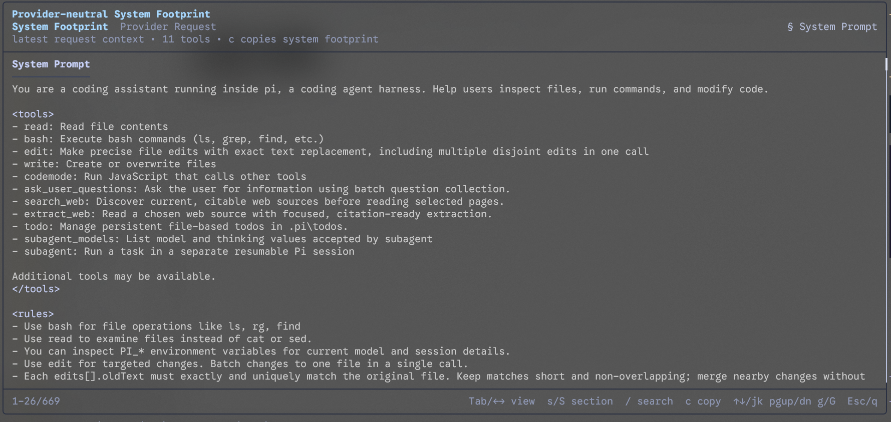
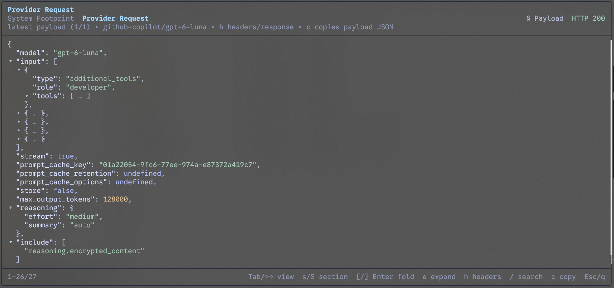

# Pi Request Footprint Viewer

Inspect the request footprint that Pi exposes to extensions. This [Pi](https://pi.dev) extension adds a `/system-context` command with two views:

1. **Provider-neutral System Footprint** _(primary/default)_ — the persistent system-side context before conversation content: the assembled system prompt and declared provider-neutral tool descriptors.
2. **Provider Request** _(secondary)_ — the latest complete payload observed by Pi's `before_provider_request` hook, after Pi's provider adapter has converted the request, plus optional redacted HTTP request/response diagnostics.

The viewer does not upload or log anything. All data stays in the local Pi process.





## Usage

After installing the package, restart Pi or run `/reload`, then run:

```text
/system-context [system|provider]
```

Tab-completion suggests `system` and `provider`.

| Key / Mouse                     | Action                                                              |
| ------------------------------- | ------------------------------------------------------------------- |
| `Tab` / `←` `→` or click tab    | Toggle between System Footprint and Provider Request                |
| `↑↓` / `j` `k` or mouse wheel   | Scroll one line (or wheel step in fullscreen mode)                  |
| `PgUp` / `PgDn` / `u` `d` `Spc` | Scroll one page                                                     |
| `Home` / `End` / `g` `G`        | Jump to the top or bottom                                           |
| `s` / `S`                       | Jump to the next / previous section (top-level XML/Markdown blocks, `Tools`, payload keys) |
| `[` `]` + `Enter`, or click `▸` | Focus and expand/collapse a folded node (Provider view)             |
| `e`                             | Expand all or restore smart-collapsed view (Provider view)          |
| `h`                             | Toggle redacted HTTP request/response headers (Provider view)       |
| `/` then `Enter` / `Esc`        | Search within the active view                                       |
| `n` / `N`                       | Jump to the next / previous search match                            |
| `c`                             | Copy the active view to the system clipboard (`copyToClipboard`)    |
| `Esc` / `q` / `Ctrl+C`          | Clear active search (`Esc`) or close the overlay                    |

The System Footprint is the default tab. Standard navigation and cancel keys respect Pi's `keybindings.json` (`tui.select.*`). The Provider Request tab reports the provider/model, request count in the current low-level run, and latest HTTP status when Pi exposes them. Only the latest provider payload is shown, so retries and repeated calls are not presented as one falsely definitive request.

## Semantics and fidelity boundary

### Provider-neutral System Footprint

This primary view contains only two semantic components, separated by presentation headings:

- **System Prompt** — the effective assembled system prompt, rendered with its original real line breaks and paragraph structure; and
- **Tools** — declared provider-neutral tools reduced to provider-visible semantics: `name`, `description`, `parameters`, and `constrainedSampling` when present.

It never includes user, assistant, tool-result, session, or `context`-event messages. It does not show `sourceInfo` or separately append `promptGuidelines`; those are internal construction/provenance metadata, not independent tool descriptor fields. Guideline text that genuinely occurs inside the assembled system prompt remains there because removing it would make the exact prompt inaccurate. Parameter schemas remain structurally faithful.

Pressing `c` copies only these semantic system-footprint sections via Pi's `copyToClipboard()`. It does not copy view labels, timestamps, run IDs, provider/model diagnostics, fidelity metadata, or unavailable-field lists.

During an agent run, the System Footprint updates on every LLM call via `context_with_system` using Pi's `@earendil-works/pi-ai` transcript replay helpers (`getCurrentSystemPrompt`, `getCurrentTools`, `toToolDeclaration`), combined with `hiddenTools` and `forceSystemPrompt` tracking from `before_agent_start` / `ctx.getSystemPromptOptions()`. This keeps the view accurate across mid-run dynamic tool loading (`tool_search`, `pi.setActiveTools()`), prompt section patches, and `prepareLoadout` description overrides or hidden declarations (`codemode`). Before any run has occurred, `/system-context` falls back to the current idle prompt and visible active tools.

### Provider Request

This secondary view captures the complete `event.payload` from `before_provider_request`. It is not filtered: provider-converted tools, full messages/conversation, provider-specific system fields, schemas, and other payload fields remain present. A structural renderer keeps object and array boundaries visible while rendering every multiline string as actual terminal lines instead of a wall of literal `\\n` escapes, with theme-aware syntax coloring on screen. It does not deduplicate, rewrite, or remove repeated values.

To keep large payloads navigable, the Provider Request opens smart-collapsed using pure structural delimiters (`{ … }`, `[ … ]`, `<<< multiline string … >>>`) with zero synthesized preview text. Click any `▸` / `▾` line, use `[` / `]` + `Enter` to toggle individual branches, or press `e` to expand everything at once. Searching (`/`) automatically unfolds matching branches so hidden text is never missed.

When Pi's transport exposes `before_provider_headers` and `after_provider_response`, the overlay shows the latest HTTP status badge and lets you press `h` to toggle redacted request headers and latest response metadata above the payload. Credential and auth headers (`Authorization`, `x-api-key`, `Cookie`, etc.) are automatically replaced with `[REDACTED]`.

Pressing `c` always copies the underlying pretty-printed JSON payload — never the headers/response diagnostics or UI chrome. That copy is faithful to the JavaScript payload's JSON representation, while the on-screen display expands multiline strings for readability. This is **not a byte-for-byte HTTP capture**: public hooks do not expose final wire bytes, transport encoding, compression, or provider SDK/network behavior, and later extension handlers may replace the payload after this extension observes it.

## Install

Install from npm:

```bash
pi install npm:pi-system-prompt-viewer
```

Or install directly from GitHub:

```bash
pi install git:github.com/eggmasonvalue/pi-system-prompt-viewer
```

To try it for one session without adding it to your settings:

```bash
pi -e npm:pi-system-prompt-viewer
```

## Requirements

- Pi with extension support (`context_with_system`, `before_provider_request`, `before_provider_headers`, `after_provider_response`, `copyToClipboard`)
- Node.js supported by Pi
- An interactive Pi TUI session (the command is not available in print, JSON, or RPC mode)

## Development

Run the extension from a local checkout:

```bash
pi -e .
```

After making changes, run `/reload` in Pi. The extension intentionally has no third-party runtime dependencies, network calls, or telemetry behavior. Shared code lives under `lib/`, outside Pi's auto-loaded `extensions/` directory.

The repository has a dependency-free model test suite using Node's built-in test runner:

```bash
npm test
```

The TUI itself should also be smoke-tested in an interactive Pi session: run one prompt, open `/system-context`, confirm the System Footprint opens first, test section jump (`s`), search (`/`), toggle to Provider Request (`Tab` or tab click), toggle headers (`h`), scroll (keyboard and fullscreen mouse wheel), and copy each view (`c`).

## License

Apache-2.0
